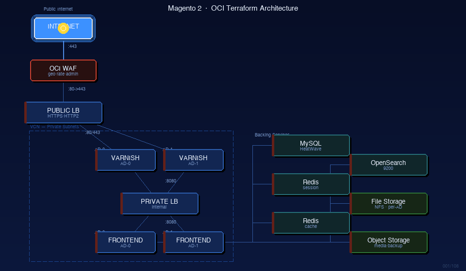

# Magento 2 — OCI Terraform

Production-ready, auto-scaling Magento 2 infrastructure on Oracle Cloud Infrastructure using Terraform and Ampere A1 ARM instances. Config-file driven — one YAML per environment, no `.tfvars` files.

[](https://www.terraform.io)
[](https://registry.terraform.io/providers/oracle/oci)
[](LICENSE)

---

## Architecture



```
                           Internet
                               │
                           OCI WAF
                    (geo-block · rate-limit · admin IP)
                               │
                    ┌──────────┴──────────┐
                    │   Public OCI LB     │  HTTPS :443 / HTTP :80 (redirect) / imgproxy :8080
                    └──────────┬──────────┘
                               │
               ┌───────────────┴────────────────┐
               ▼                                ▼
  ┌─────────────────────┐          ┌─────────────────────┐
  │  Varnish Pool       │          │  Frontend Pool      │  (imgproxy :8080)
  │  AD-0 + AD-1        │          │  AD-0 + AD-1        │
  │  ARM A1 Flex        │          │  ARM A1 Flex        │
  │  min:2 → max:8      │          │  min:2 → max:8      │
  └──────────┬──────────┘          └─────────────────────┘
             │  :8080                        ▲
             │                               │
             ▼                               │
  ┌─────────────────────┐                    │
  │  Private OCI LB     │────────────────────┘
  │  (internal, :8080)  │  Varnish → Frontend (stays in VCN)
  └─────────────────────┘
             │
  ┌──────────┼────────────────────────────┐
  ▼          ▼                            ▼
MySQL     Redis (session + cache)    OpenSearch
HeatWave  OCI Cache                  Cluster
  │          │                            │
  └──────────┴──────── private subnets ───┘

                    Object Storage          NFS File Storage
                  (media · backup · system)  (var/ · pub/media/)
                                             per-AD mount target
```

**Traffic path:** Internet → OCI WAF → Public LB → Varnish (full-page cache) → Private internal LB → Frontend (Nginx + PHP-FPM) → MySQL / Redis / OpenSearch

**No cross-AZ hairpin:** Varnish-to-Frontend traffic stays inside the VCN via the private internal LB. NFS mounts use the local AD's mount target.

---

## What is provisioned

| Component | OCI Resource | Notes |
|---|---|---|
| Cache tier | Instance Pool (Varnish, ARM A1 Flex) | Multi-AD, CPU autoscaling |
| Web tier | Instance Pool (Nginx + PHP-FPM, ARM A1 Flex) | Multi-AD, CPU autoscaling |
| Public LB | OCI Flexible Load Balancer | HTTPS, HTTP→HTTPS redirect, WAF attached |
| Internal LB | OCI Flexible Load Balancer (private) | Varnish → Frontend, stays in VCN |
| WAF | OCI WAF v2 | Geo-block, rate-limit, admin path IP restriction |
| Database | MySQL HeatWave | HA in production, configurable params |
| Session cache | OCI Cache (Redis) | Per-cluster node count + AD placement |
| Full-page cache | OCI Cache (Redis) | Separate cluster from session |
| Search | OCI OpenSearch | Configurable data/master/dashboard nodes |
| Shared files | OCI File Storage (NFS) | Per-AD mount targets, NFSv4 |
| Media storage | OCI Object Storage | Versioned, private |
| Secrets | OCI Vault (KMS) | AES-256, prevent_destroy |
| DNS | OCI DNS (public + private) | Public A/CNAME + internal service discovery |
| Ops access | OCI Bastion Service | SSH to private instances, no open port 22 |
| Monitoring | OCI Monitoring Alarms | CPU, memory, LB, MySQL, Redis, OpenSearch |
| Budget | OCI Budgets | Monthly alert at configurable threshold |

---

## Prerequisites

- Terraform ≥ 1.9
- OCI CLI configured (`oci setup config`) or environment variables set
- An OCI tenancy with sufficient service limits for A1 Flex instances
- A compartment with IAM policies to create compute, networking, database, and storage resources

See [docs/deployment.md](docs/deployment.md) for full IAM policy requirements.

---

## Quick start

```bash
# 1. Clone
git clone https://github.com/easecloudio/magento2-oci-terraform.git
cd magento2-oci-terraform

# 2. Configure
cp developer.config.yaml myproject.config.yaml
# Edit: set brand, codename, domain, admin_email, oci.tenancy_ocid, oci.compartment_ocid

# 3. Initialize and create workspace (name must match config file prefix)
terraform init
terraform workspace new developer

# 4. Plan and apply
terraform plan -out developer.plan
terraform apply developer.plan
```

After apply, view all service endpoints:

```bash
terraform output
```

---

## Configuration

All settings live in `<workspace>.config.yaml`. Three files ship with this repo:

| File | Purpose |
|---|---|
| `developer.config.yaml` | Single-node backing services, 2 compute instances, open WAF |
| `staging.config.yaml` | Mid-range sizing, separated Redis ADs, 1 OpenSearch master |
| `production.config.yaml` | HA MySQL, 3-node Redis spread across ADs, 3+3 OpenSearch |

Copy and edit the file that matches your target workspace. The workspace name **must match** the config file prefix (`terraform workspace new production` uses `production.config.yaml`).

See [docs/configuration.md](docs/configuration.md) for a full reference of every key.

**Key sections:**

```yaml
brand: mystore            # used in all resource display names
codename: magento         # combined with brand: mystore-magento
domain: store.example.com
admin_email: ops@example.com

oci:
  region: us-ashburn-1
  tenancy_ocid: ""        # fill in
  compartment_ocid: ""    # fill in

compute:
  frontend:
    desired_capacity: 2   # starting instance count
    min_size: 2           # autoscaling floor
    max_size: 8           # autoscaling ceiling

redis:
  clusters:
    - { name: session, node_count: 1, subnet_index: 0 }
    - { name: cache,   node_count: 1, subnet_index: 0 }

waf:
  restricted_countries: [CN, RU, IR, KP]
  admin_allowed_cidrs: []   # set to your office CIDRs in production
```

---

## Input variables

Passed via `-var` or `TF_VAR_*` environment variables:

| Variable | Type | Default | Description |
|---|---|---|---|
| `ssh_public_key` | `string` | `""` | SSH public key injected into instances. Empty = no key injected. |
| `bastion_allowed_cidrs` | `list(string)` | `[]` | CIDRs allowed to open Bastion sessions. Empty = no sessions allowed. |
| `ssl_certificate_pem` | `string` | `""` | PEM certificate chain for HTTPS. Empty = HTTP only. |
| `ssl_private_key_pem` | `string` | `""` | PEM private key for HTTPS. Supply via `TF_VAR_ssl_private_key_pem`. |

---

## Outputs

```bash
terraform output load_balancer_ip      # public IP — point your DNS A record here
terraform output mysql_endpoint        # MySQL hostname for app config
terraform output redis_endpoints       # map: session → IP, cache → IP
terraform output opensearch_endpoint   # https://fqdn:9200
terraform output nfs_mount_target_ip   # map: "0" → AD-0 IP, "1" → AD-1 IP
terraform output internal_lb_ip        # private IP of the Varnish→Frontend LB
terraform output bastion_private_ip    # OCI Bastion endpoint IP
```

---

## Multi-environment workflow

```bash
# Create all three environments
terraform workspace new developer  && terraform apply -auto-approve
terraform workspace new staging    && terraform apply -auto-approve
terraform workspace new production && terraform apply -auto-approve

# Switch between them
terraform workspace select production
terraform plan -out production.plan
terraform apply production.plan
```

Each workspace maintains its own Terraform state and reads its own config file. Resources in different workspaces are completely independent.

---

## Accessing instances (no public SSH)

Instances are in private subnets with no public IP. Two methods to access them:

**OCI Bastion (recommended):**

```bash
# Create a managed SSH session
oci bastion session create-managed-ssh \
  --bastion-id <bastion-ocid> \
  --target-resource-id <instance-ocid> \
  --target-os-username opc \
  --ssh-public-key-file ~/.ssh/id_rsa.pub

# Connect once the session is ACTIVE
ssh -i ~/.ssh/id_rsa \
  -o ProxyCommand='ssh -W %h:%p -p 22 ocid1.bastionsession.xxx@host.bastion.us-ashburn-1.oci.oraclecloud.com' \
  opc@<instance-private-ip>
```

The bastion OCID is in `terraform output bastion_private_ip`. Your source IP must be in `var.bastion_allowed_cidrs`.

**Oracle Cloud Agent — Run Command** (no network path required):

```bash
oci instance-agent command create \
  --compartment-id <compartment-ocid> \
  --execution-time-out-in-seconds 600 \
  --target '{"instanceId": "<instance-ocid>"}' \
  --content '{"source": {"sourceType": "TEXT", "text": "journalctl -u cloud-init --no-pager -n 100"}}'
```

---

## Security model

- **No public instance IPs** — all compute in private subnets behind a NAT gateway
- **NSGs per service** — each tier (LB, compute, DB, Redis, NFS, OpenSearch) has its own Network Security Group with minimum-required rules
- **WAF** — geo-blocking, 100 req/min global rate limit, 20 req/min on admin path, optional admin path IP allowlist
- **Secrets in Vault** — all generated passwords (MySQL, Redis, OpenSearch) and tokens (admin path, health check, security header) are stored as AES-256 encrypted secrets in OCI Vault with `prevent_destroy`
- **IAM least-privilege** — compute instances access only named buckets (not the full compartment), use `instance_principal` auth; no long-lived API keys on instances
- **TLS** — supply `TF_VAR_ssl_certificate_pem` and `TF_VAR_ssl_private_key_pem` to enable HTTPS with TLS 1.2/1.3 and HTTP/2

See [docs/security.md](docs/security.md) for a full breakdown.

---

## Monitoring

Eight OCI Monitoring alarms send email to `admin_email` via ONS:

| Alarm | Trigger |
|---|---|
| `cpu-high` | Compute CPU > 85% for 5 min |
| `memory-high` | Compute memory > 90% for 5 min |
| `lb-5xx` | LB 5xx responses > 50 in 5 min |
| `lb-unhealthy-backends` | Any unhealthy backend for 2 min |
| `mysql-connections-high` | DB connections > 80 for 5 min |
| `mysql-storage-low` | Free storage < 10 GB for 2 min |
| `redis-*-memory-high` | Redis memory > 80% for 5 min (per cluster) |
| `opensearch-cluster-unhealthy` | Cluster status non-green for 2 min |

---

## Repository layout

```
.
├── *.tf                      Terraform resources (one file per concern)
├── *.config.yaml             Environment configurations (developer/staging/production)
├── variables.tf              Input variable declarations
├── outputs.tf                Output values
├── locals.tf                 Derived locals and lookup maps
├── cloud-init/
│   ├── frontend.yaml         Cloud-init for Nginx + PHP-FPM instances
│   └── varnish.yaml          Cloud-init for Varnish instances
├── ansible/
│   └── playbooks/
│       ├── frontend.yml      Installs Nginx, PHP-FPM, mounts NFS, fetches secrets
│       └── varnish.yml       Writes Magento VCL, configures Varnish on :80
├── docs/
│   ├── architecture.md       Detailed architecture and traffic flow
│   ├── configuration.md      Full YAML configuration reference
│   ├── deployment.md         Step-by-step deployment guide
│   ├── operations.md         Day-2 operations (scaling, backups, upgrades)
│   ├── security.md           Security model and hardening guide
│   └── troubleshooting.md    Common issues and solutions
└── .github/
    └── workflows/            CI: tflint + Checkov security scanning
```

---

## Contributing

Pull requests are welcome. Please:

1. Fork the repository and create a feature branch
2. Follow the existing file-per-concern Terraform structure
3. Add new config keys to all three `*.config.yaml` files with the same structure
4. Run `terraform fmt` and `terraform validate` before submitting
5. Update `docs/configuration.md` if you add new config keys

The CI pipeline runs `tflint` and `checkov` on every pull request.

---

## License

Apache 2.0 — see [LICENSE](LICENSE)
